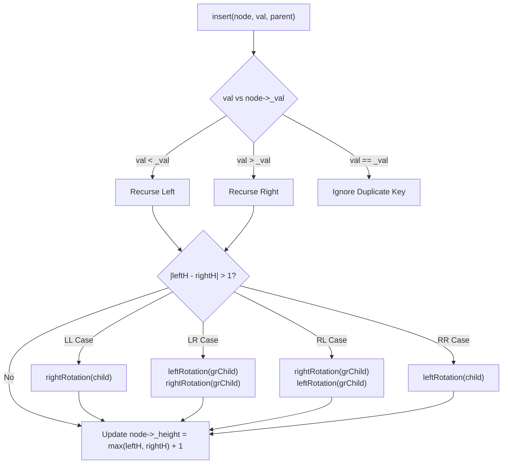

# Set — Self-Balancing AVL Binary Search Tree in C++


A C++ implementation of an ordered associative container of unique keys (`Set`), developed as part of a university **Data Structures** course. Modeled after `std::set<int>` from the C++ Standard Template Library (STL), `Set` is backed by a **Self-Balancing AVL Binary Search Tree** with parent pointers, guaranteeing strict $O(\log N)$ worst-case time complexity for insertions, lookups, range bound queries (`lower_bound`, `upper_bound`), and bidirectional in-order iteration.

---

## Table of Contents

- [Overview](#overview)
- [Key Technical Features](#key-technical-features)
- [AVL Balancing & Rotation Mechanics](#avl-balancing--rotation-mechanics)
- [Project Structure](#project-structure)
- [API Reference & Complexity](#api-reference--complexity)
- [Code Examples](#code-examples)
- [Test Suite & 1M-Element Benchmark](#test-suite--1m-element-benchmark)
- [Building & Running](#building--running)
- [Author](#author)

---

## Overview

A naive Binary Search Tree (BST) degenerates into an $O(N)$ linked list when keys are inserted in sorted order (e.g., `0, 1, 2, ..., 999999`), causing both $O(N^2)$ runtime and call-stack overflow. To match the logarithmic performance guarantees of `std::set`, this repository implements an **AVL Tree** in [`Set/Set.h`](Set/Set.h) and [`Set/Set.cpp`](Set/Set.cpp).

Every `Node` maintains its subtree height (`_height`), parent pointer (`_parent`), and left/right child pointers (`_left`, `_right`). Whenever an insertion causes any ancestor's balance factor $|h(\text{left}) - h(\text{right})|$ to exceed `1`, `Set` restores the AVL invariant in $O(1)$ structural rotations (`leftRotation` / `rightRotation`).

---

## Key Technical Features

- **Strict AVL Height Balancing ($|h_L - h_R| \le 1$)**
  - Handles all four imbalance configurations on the unwind path of `insert`:
    - **Left-Left (LL)**: Single `rightRotation(child)`
    - **Left-Right (LR)**: Double rotation — `leftRotation(grChild)` followed by `rightRotation(grChild)`
    - **Right-Left (RL)**: Double rotation — `rightRotation(grChild)` followed by `leftRotation(grChild)`
    - **Right-Right (RR)**: Single `leftRotation(child)`
  -Sustains **1,000,000 sequential insertions** (`0 .. 999,999`) in **under 1 second** (`12TimeLimitTest.h`).
- **Parent-Pointer Bidirectional In-Order Iterator (`Set::iterator`)**
  - Conforms to `std::bidirectional_iterator_tag` without auxiliary traversal stacks.
  - `operator++()` advances to `inorder_next(_current)` (leftmost node of right subtree, or first ancestor where current branch is a left child).
  - `operator--()` retreats to `inorder_prev(_current)` (rightmost node of left subtree, or first ancestor where current branch is a right child).
  - Compatible with range-based `for` loops and STL `<algorithm>` functions (`std::find`, etc.).
- **Three-Case BST Node Erasure (`erase(int)` & `erase(iterator)`)**
  - Modularized into `remove_leaf(Node*)`, `remove_1_child_node(Node*)`, and `remove_2_child_node(Node*)` (which replaces the target's value with its in-order successor or predecessor and removes the leaf/1-child donor node).
- **Logarithmic Bound Queries (`lower_bound` & `upper_bound`)**
  - `lower_bound(val)` returns an iterator to the first element $\ge \text{val}$ (or `end()`).
  - `upper_bound(val)` returns an iterator to the first element $> \text{val}$ (or `end()`).
- **Breadth-First Level-Order Copy (`Set(const Set&)` & `operator=`)**
  - Uses a `std::queue<Node*>` level-order BFS traversal to clone the source tree structure efficiently.

---

## AVL Balancing & Rotation Mechanics



---

## Project Structure

```text
Set/
├── Set.sln                                             # Visual Studio 2022 Solution
├── .gitignore                                          # Visual Studio & build artifact ignores
├── README.md                                           # Project documentation
│
└── Set/
    ├── Set.h                                           # Set class & bidirectional iterator declarations
    ├── Set.cpp                                         # AVL rotations, insertion, deletion, bounds & iterators
    ├── main.cpp                                        # Test runner entry point
    ├── Set.vcxproj                                     # MSVC project configuration (v143)
    ├── Set.vcxproj.filters                             # Solution Explorer filters
    │
    └── Tests/                                          # 12 Modular TDD Test Suites
        ├── 1BasicConstructorsTest.h                    # Default constructor, size(), and empty()
        ├── 2InsertContainsTest.h                       # insert(), duplicate suppression, and contains()
        ├── 3EraseValueTest.h                           # erase(int) across leaf, 1-child, and 2-child nodes
        ├── 4InitializerListTest.h                      # std::initializer_list<int> constructor
        ├── 5CopyConstructorTest.h                      # BFS deep copy constructor & mutation independence
        ├── 6AssignmentOperatorTest.h                   # Copy assignment & self-assignment safety
        ├── 7IteratorTest.h                             # Bidirectional ++ and -- in-order traversal
        ├── 8IteratorStlCompatibilityTest.h             # Range-based for & std::find compatibility
        ├── 9FindTest.h                                 # find(int) returning iterator or end()
        ├── 10UpperAndLowerBoundsTest.h                 # lower_bound() and upper_bound() edge cases
        ├── 11EraseIteratorTest.h                       # Dynamic insert & erase(iterator) stress test
        ├── 12TimeLimitTest.h                           # 1,000,000 sequential insertions in < 1000ms
        └── Fixtures/
            └── CustomAsserts.h                         # Test assertion templates & diagnostics
```

---

## API Reference & Complexity

| Member | Signature | Time Complexity | Description |
| :--- | :--- | :---: | :--- |
| **Default Ctor** | `Set()` | $O(1)$ | Initializes an empty set (`_root = nullptr`, `_size = 0`). |
| **Initializer List Ctor** | `Set(std::initializer_list<int> initList)` | $O(N \log N)$ | Inserts all unique elements from `initList`. |
| **Copy Ctor** | `Set(const Set& source)` | $O(N \log N)$ | Clones `source` via BFS level-order traversal. |
| **Destructor** | `~Set()` | $O(N)$ | Recursively deletes `_root` and all descendant nodes. |
| **Copy Assignment** | `Set& operator=(const Set& source)` | $O(N \log N)$ | Destroys current tree and clones `source` (self-assignment safe). |
| `size` / `empty` | `size_t size()`, `bool empty()` | $O(1)$ | Returns active element count or whether `_size == 0`. |
| `insert` | `void insert(int val)` | $O(\log N)$ | Inserts `val` if not present and rebalances ancestors via AVL rotations. |
| `contains` | `bool contains(int val)` | $O(\log N)$ | Returns `true` if `val` exists in the set. |
| `find` | `iterator find(int val)` | $O(\log N)$ | Returns an iterator to `val`, or `end()` if not found. |
| `erase` (by value) | `void erase(int val)` | $O(\log N)$ | Removes `val` if present (handling 0, 1, or 2 children). |
| `erase` (by iterator) | `void erase(iterator it)` | $O(\log N)$ | Removes the node referenced by `it`. |
| `lower_bound` | `iterator lower_bound(int val)` | $O(\log N)$ | Returns iterator to the smallest element $\ge \text{val}$, or `end()`. |
| `upper_bound` | `iterator upper_bound(int val)` | $O(\log N)$ | Returns iterator to the smallest element $> \text{val}$, or `end()`. |
| `begin` / `end` | `iterator begin()`, `iterator end()` | $O(\log N)$ / $O(1)$ | `begin()` returns iterator to `min()`; `end()` returns `iterator(nullptr)`. |
| `operator==` / `!=` | `bool operator==(const Set& lhs, const Set& rhs)` | $O(N)$ | Compares sets in sorted order using `inorder_next`. |

---

## Code Examples

```cpp
#include "Set/Set.h"
#include <iostream>

int main()
{
    Set s = { 20, 10, 30, 5, 14, 26, 40, 10 }; // Duplicate 10 is ignored

    s.insert(17);
    s.erase(5);

    // In-order sorted iteration
    for (int x : s)
        std::cout << x << " "; // Output: 10 14 17 20 26 30 40
    std::cout << "\n";

    // Logarithmic bound queries
    auto lb = s.lower_bound(20); // *lb == 20
    auto ub = s.upper_bound(20); // *ub == 26
    std::cout << "lower_bound(20) = " << *lb << ", upper_bound(20) = " << *ub << "\n";
    return 0;
}
```

---

## Test Suite & 1M-Element Benchmark

All **12 test suites** in [`Set/Tests/`](Set/Tests/) run automatically during static initialization before `main()`:

| # | Test File | Verified Behavior |
| :-: | :--- | :--- |
| **1** | [`1BasicConstructorsTest.h`](Set/Tests/1BasicConstructorsTest.h) | Default construction, `size() == 0`, and `empty() == true`. |
| **2** | [`2InsertContainsTest.h`](Set/Tests/2InsertContainsTest.h) | Inserting keys, ignoring duplicates, and querying `contains()`. |
| **3** | [`3EraseValueTest.h`](Set/Tests/3EraseValueTest.h) | Removing leaf, 1-child, and 2-child nodes by value. |
| **4** | [`4InitializerListTest.h`](Set/Tests/4InitializerListTest.h) | Construction from `std::initializer_list<int>`. |
| **5** | [`5CopyConstructorTest.h`](Set/Tests/5CopyConstructorTest.h) | Deep copy construction, `operator==`, `operator!=`, and mutation isolation. |
| **6** | [`6AssignmentOperatorTest.h`](Set/Tests/6AssignmentOperatorTest.h) | Copy assignment and self-assignment (`s = s`). |
| **7** | [`7IteratorTest.h`](Set/Tests/7IteratorTest.h) | Forward (`++`) and backward (`--`) in-order traversal across the tree. |
| **8** | [`8IteratorStlCompatibilityTest.h`](Set/Tests/8IteratorStlCompatibilityTest.h) | Range-based `for` loop and `std::find(set.begin(), set.end(), ...)` compatibility. |
| **9** | [`9FindTest.h`](Set/Tests/9FindTest.h) | `find()` for existing and non-existing elements. |
| **10** | [`10UpperAndLowerBoundsTest.h`](Set/Tests/10UpperAndLowerBoundsTest.h) | `lower_bound()` and `upper_bound()` on exact matches, gaps, and out-of-range keys. |
| **11** | [`11EraseIteratorTest.h`](Set/Tests/11EraseIteratorTest.h) | Incremental insertion and `erase(iterator)` verification against `std::sort`. |
| **12** | [`12TimeLimitTest.h`](Set/Tests/12TimeLimitTest.h) | **Performance Benchmark**: Inserts $1,000,000$ sequential integers (`0 .. 999,999`) and asserts completion in $< 1000\text{ ms}$. |

---

## Building & Running

### Option 1: Visual Studio 2022

1. Open `Set.sln` in **Visual Studio 2022**.
2. Select **Release / x64** (recommended for the 1,000,000-insertion benchmark in `12TimeLimitTest.h`) or **Debug / x64**.
3. Build (`Ctrl + Shift + B`) and run (`Ctrl + F5`).

### Option 2: Command-Line Compilation (MSVC / GCC / Clang)

**MSVC:**
```powershell
cl /EHsc /O2 /std:c++20 /W3 Set\main.cpp Set\Set.cpp /Fe:set_tests.exe
.\set_tests.exe
```

**GCC / Clang:**
```bash
g++ -std=c++20 -O2 -Wall -Wextra Set/main.cpp Set/Set.cpp -o set_tests
./set_tests
```

**Expected Output:**
```text
All tests passed!
```

---

## Author

- **Davit Bakhshyan** — [@DavitBakh](https://github.com/DavitBakh)
